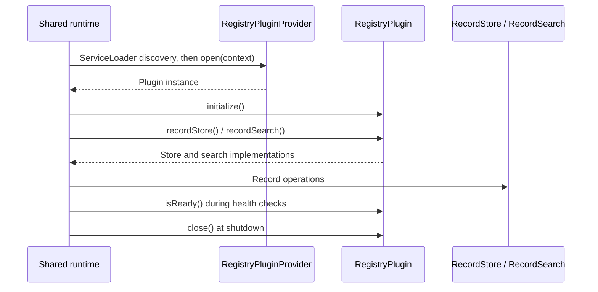

<!--
Licensed to the Apache Software Foundation (ASF) under one or more
contributor license agreements. See the NOTICE file distributed with
this work for additional information regarding copyright ownership.
The ASF licenses this file to You under the Apache License, Version 2.0
(the "License"); you may not use this file except in compliance with
the License. You may obtain a copy of the License at

    http://www.apache.org/licenses/LICENSE-2.0

Unless required by applicable law or agreed to in writing, software
distributed under the License is distributed on an "AS IS" BASIS,
WITHOUT WARRANTIES OR CONDITIONS OF ANY KIND, either express or implied.
See the License for the specific language governing permissions and
limitations under the License.
-->

# Developing a storage plugin

A storage plugin implements the Registry's JDK-only SPI. It can live in a separate
repository and use a backend SDK without changing Core or the HTTP runtime.
The [standalone example](../examples/storage-plugin/README.md) is a complete,
buildable project; the [storage contract](storage-spi.md) defines the record and
failure semantics in detail.

## Project layout and dependencies

The example separates the plugin JAR from the executable application:

```text
storage-plugin/
  pom.xml                 Independent Maven parent
  plugin/                 Provider, storage implementation, registration, TCK test
  application/            Runtime dependencies, configuration, packaged-app test
```

| Module | Production dependencies | Test dependencies |
|---|---|---|
| Plugin | `sourcelume-registry-spi` and your backend's client libraries | `sourcelume-registry-spi-tck` |
| Application | `sourcelume-registry-runtime-quarkus` and your plugin | Quarkus integration-test support and REST Assured |

The plugin does not need the Registry parent POM, Core, Atlas, or Quarkus. Its
runtime dependency on Registry is just the SPI artifact. The TCK belongs in test
scope and supplies the JUnit contract suite. The application owns its Quarkus BOM
and build plugin; use the Quarkus version pinned by the Registry version you consume.
Keep the SPI, runtime and TCK on the same Registry version.

For example, the plugin's dependencies are:

```xml
<dependency>
  <groupId>org.apache.sourcelume</groupId>
  <artifactId>sourcelume-registry-spi</artifactId>
  <version>${sourcelume.version}</version>
</dependency>
<dependency>
  <groupId>org.apache.sourcelume</groupId>
  <artifactId>sourcelume-registry-spi-tck</artifactId>
  <version>${sourcelume.version}</version>
  <scope>test</scope>
</dependency>
```

The current snapshot artifacts must be installed locally. Follow the example's
[build commands](../examples/storage-plugin/README.md#build-and-run); they install
only the runtime, SPI, TCK and their dependencies, so developing this example does
not require an Atlas or PostgreSQL server.

## Implement the provider and plugin

The entry point is a public `RegistryPluginProvider` implementation with a public
no-argument constructor. `id()` supplies a unique provider ID; the example uses
`example`. Its constructor must not connect to the backend: ServiceLoader can
instantiate providers while the runtime is selecting one.

`open(PluginContext)` reads configuration and creates one `RegistryPlugin` instance.
The plugin owns its clients, storage and search implementations. Backend-specific
schema creation belongs in `initialize()`, which the runtime calls during startup.

| Interface and methods | Responsibility |
|---|---|
| `RegistryPluginProvider.id()` / `open(context)` | Provider identity, configuration and plugin creation |
| `RegistryPlugin.recordStore()` / `recordSearch()` | Return implementations operating on the same backend |
| `RegistryPlugin.initialize()` | Idempotently prepare backend resources and schema |
| `RegistryPlugin.isReady()` | Report whether the backend can serve requests |
| `RegistryPlugin.close()` | Release owned resources; repeated calls must be safe |
| `RecordStore.limits()` / `writeGuarantee()` | Declare enforced payload limits and conditional-write guarantees |
| `RecordStore.get(id)` / `getAll(ids)` | Authoritative reads returning complete snapshots |
| `RecordStore.write(request)` | Check the write condition and persist the complete replacement |
| `RecordSearch.search(query)` | Apply type, status and exact facet filters with the requested result limit |

The example uses two classes: `ExamplePluginProvider` and `InMemoryPlugin`.
The latter implements storage and search over one map. A backend with a client,
schema manager or substantial query logic can keep those as internal classes;
none of their types belongs in the public SPI.

The lifecycle and request paths are:



The runtime opens only the selected provider. Initialization failures are retried
according to the runtime configuration and keep readiness down if retries are
exhausted. Health checks combine initialization state with `isReady()`. The runtime
closes the plugin at shutdown; plugins must reject further storage operations.
Keep backend SDK exceptions inside the plugin and translate them into SPI failures.

## Register the provider

Create this file inside the plugin JAR:

```text
src/main/resources/META-INF/services/org.apache.sourcelume.registry.spi.RegistryPluginProvider
```

Its content is the provider's fully qualified class name:

```text
org.example.sourcelume.ExamplePluginProvider
```

No CDI annotation, custom launcher or Core registration change is needed. Select
the provider by ID in the application's `application.properties`:

```properties
sourcelume.storage.provider=example
sourcelume.storage.require-atomic-writes=true
sourcelume.example.max-document-bytes=${EXAMPLE_MAX_DOCUMENT_BYTES:4096}
```

The provider JAR and its backend dependencies must be included when building the
application. The runtime discovers providers on the application classpath at
startup. Use the ordinary plugin JAR so its service descriptor is preserved.

## Pass configuration to the plugin

`StorageProducer` collects `sourcelume.<provider-id>.*` settings and strips that
prefix before creating `PluginContext`. In the example,
`sourcelume.example.max-document-bytes` becomes `max-document-bytes`:

```java
int maxDocumentBytes = Integer.parseInt(
        context.properties().getOrDefault("max-document-bytes", "4194304"));
StoreLimits limits = StoreLimits.builder()
        .maxDocumentBytes(maxDocumentBytes)
        .build();
```

Declare provider keys and environment-variable mappings in the application's
configuration, as above. This gives configuration enumeration an unambiguous
property name, including keys containing hyphens. Validate required values in
`open()` and fail clearly if they are missing or invalid. Do not log the properties
map: it may contain credentials. The provider should consume `PluginContext`
rather than reading framework configuration or environment variables itself.

## Preserve the storage contract

Core supplies a `RecordEnvelope` containing the exact document bytes, display
attributes, validation metadata, extracted facets and opaque attachments. Store
that snapshot without reserializing the document or dropping fields. An update
replaces the whole snapshot, including clearing removed facets and attachments.
An attachment is bound to the document digest; its signature format is outside the
storage plugin's responsibility.

Writes carry either `WriteCondition.absent()` or `WriteCondition.atRevision(...)`.
The plugin enforces the condition, domain-type immutability and the immutability of
validated records. Return the confirmed stored snapshot and its opaque revision.
A rejected condition throws `RecordConflictException` with the current snapshot
when one exists. See the [condition table](storage-spi.md#conditions-and-failures)
for the required outcomes.

Declare `ATOMIC_CONDITIONAL` only when the condition check and complete write are
atomic for all writers sharing that store. The example synchronizes access to a
single in-process map. That lock is not a concurrency mechanism for a shared remote
backend; use that backend's transaction or conditional-write support. If the
backend provides only `CHECK_THEN_WRITE`, document its writer restrictions. The
runtime rejects it when `sourcelume.storage.require-atomic-writes=true`.

`get()` returns `Optional.empty()` only when the record is missing. Backend failures
must throw. The default `getAll()` performs point reads; a plugin may override it
with an authoritative batch lookup. Missing IDs are omitted, duplicates are read
once, and a failure rejects the entire call. Each record must be a complete
snapshot; a search index is not an authoritative batch-read source.

Search can lag point reads. It must honor exact facet matching, OR within a facet,
AND across facets, and the result limit. Core extracts the facet values; plugins
persist and index them. An unsupported operation or failed query must not look
like a successful empty result. Storage and facet search are required by the current
SPI; graph support is a separate future contract.

Use `StorageException` for backend failures. `UNKNOWN_WRITE` means a mutation may
have committed but its result cannot be established. Do not turn a timeout into a
successful write or a definitive conflict without sufficient backend evidence.
Enforce `StoreLimits` before mutation and before consuming large backend resources.
The [PostgreSQL](../sourcelume-registry-postgres/src/main/java/org/apache/sourcelume/registry/postgres/)
and [Atlas](../sourcelume-registry-atlas-adapter/src/main/java/org/apache/sourcelume/registry/atlas/adapter/)
implementations show transaction-based and single-writer approaches respectively.

## Run the contract tests and package the application

Extend `RecordStoreContract` in your plugin's test sources. `createPlugin()` must
return an initialized plugin backed by an empty, isolated store for each test:

```java
class ExamplePluginContractTest extends RecordStoreContract {
    @Override
    protected RegistryPlugin createPlugin() {
        RegistryPlugin plugin = new ExamplePluginProvider()
                .open(PluginContext.builder().build());
        plugin.initialize();
        return plugin;
    }
}
```

The base test closes the plugin after each test. For a persistent backend, create a
fresh test namespace or reset a dedicated test database; never use a live registry.
The TCK covers byte preservation, complete replacement, revisions, conflicts,
concurrent writes, batch reads, payload limits, search filters and limits, repeated
initialization, and access after close. Limit tests accept the declared boundary
and reject oversized creates and corrections without changing the stored snapshot.
Search assertions allow index lag and do not require a particular result order.

Use modest limits in the test instance: to bound test allocations, the TCK skips
a payload boundary test above 16 MiB or an attachment count test above 1024.
The combined attachment byte test also skips stores that allow no attachments.
Check the test reports for skips; a skipped dimension has not been verified.
Backend-specific tests must also cover failures and guarantees that a shared
contract test cannot induce, such as a lost commit acknowledgement or a partial
schema migration.

The application module depends on the runtime JAR and your plugin JAR, imports the
Quarkus BOM, and binds `quarkus-maven-plugin:build`. It needs no HTTP resource
classes: the runtime already provides the record API, validators, health checks
and shutdown handling. The example's `PluginApplicationIT` runs the resulting
fast-jar and verifies that the registered provider serves requests and receives
its configuration. It also checks that TCK, JUnit, Atlas and PostgreSQL libraries
are absent from this application's production package.

When packaging another backend, replace the example's implementation and provider
ID, add its SDK dependency to the plugin module, and declare its configuration in
the application. Run both the TCK and the packaged application test before shipping.

## Troubleshooting

| Symptom | Check |
|---|---|
| `No storage provider named ...` | The configured ID, plugin dependency, provider class name and service descriptor in the built JAR |
| `Multiple storage providers named ...` | Two provider implementations on the classpath use the same ID |
| An environment setting has no effect | The application declares the matching `sourcelume.<id>.*` property and the provider reads the stripped key |
| Startup rejects atomic-write requirements | The selected store's `writeGuarantee()` and the distribution's atomic-write policy |
| Readiness stays down | Initialization logs, backend connectivity and the plugin's `isReady()` implementation |
| Tests run but HTTP startup fails | The application packages the plugin and imports the Quarkus BOM matching the Registry runtime |
