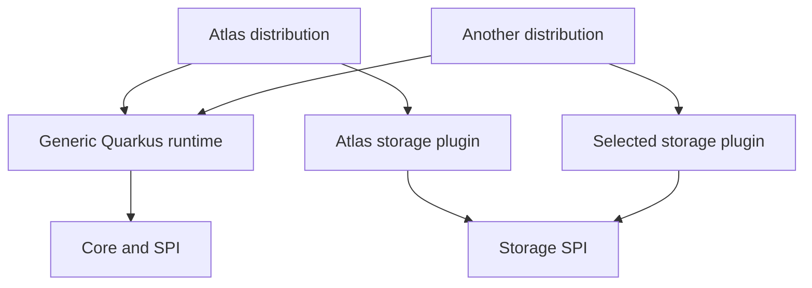
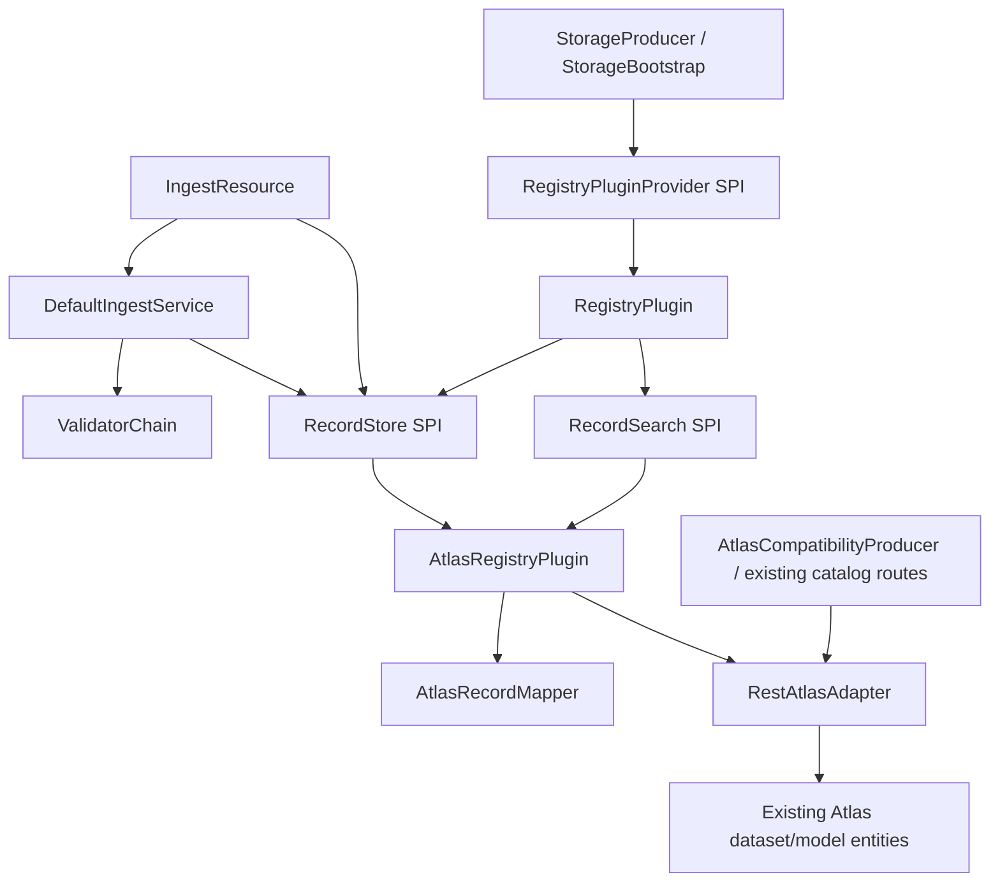

<!--
Licensed to the Apache Software Foundation (ASF) under one or more
contributor license agreements. See the NOTICE file distributed with
this work for additional information regarding copyright ownership.
The ASF licenses this file to You under the Apache License, Version 2.0
(the "License"); you may not use this file except in compliance with
the License. You may obtain a copy of the License at

    http://www.apache.org/licenses/LICENSE-2.0

Unless required by applicable law or agreed to in writing, software
distributed under the License is distributed on an "AS IS" BASIS,
WITHOUT WARRANTIES OR CONDITIONS OF ANY KIND, either express or implied.
See the License for the specific language governing permissions and
limitations under the License.
-->

# Metadata storage SPI

## Scope

The Registry's ingest and record retrieval paths use a backend-independent
storage contract. Atlas is the default provider in the Atlas distribution.
Another provider implements the same SPI without depending on Atlas or Core.

The Atlas distribution retains the existing HTTP routes, validation status codes,
top-level response fields, and Atlas dataset/model entities. The storage schema
gains optional attributes for revisions, attachments, lossless presentation
attributes and exact-match facet indexes. DataHub integration, graph query
execution and a new HTTP submission format are separate changes. Existing
indexed Atlas attributes remain available; extracting the SPI does not remove them.

## Modules and ownership

| Module | Responsibility | Production dependencies within Registry |
|---|---|---|
| `sourcelume-registry-spi` | Plugin interfaces, immutable snapshots, conditions and failures | None; JDK only |
| `sourcelume-registry-spi-tck` | Reusable storage contract tests and an independent in-memory test implementation | SPI; consumers use test scope |
| `sourcelume-registry-common` | Spec DTOs, parsers, resource loading and existing catalog response DTOs | SPI |
| `sourcelume-registry-core` | Validation, submission policy, plugin selection | SPI, Common |
| `sourcelume-registry-atlas-adapter` | Atlas provider, REST transport, schema initialization and entity mapping | SPI, Common, Typedefs |
| `sourcelume-registry-postgres` | PostgreSQL provider, JDBC storage, schema migrations and facet search | SPI |
| `sourcelume-registry-runtime-quarkus` | Reusable HTTP runtime, SPI configuration, CDI wiring, startup, readiness and shutdown | Core, SPI, Common and validators; no storage implementation |
| `sourcelume-registry-distribution-atlas` | Atlas dataset/type HTTP routes, Atlas error mapping, provider configuration, executable Quarkus application and Docker packaging | Generic runtime and Atlas adapter |

The runtime is an ordinary JAR with a bean archive descriptor. The Atlas
distribution owns its catalog HTTP routes, provider configuration and Quarkus
build. To assemble another provider, depend on the generic runtime
and that provider, set `sourcelume.storage.provider`, and build the application
in the distribution module. Neither the Atlas adapter nor its typedefs are
required by the generic runtime.

Shared HTTP defaults live in the runtime's `META-INF/microprofile-config.properties`.
The distribution's `application.properties` supplies its provider and connection
defaults. The runtime requires an explicit provider selection; it does not fall
back to Atlas. The Atlas distribution preserves the existing environment variables.






`RecordStore` and `RecordSearch` access the same backend. There is no additional
record database, synchronization service or outbox. `AtlasAdapter` now belongs
to the Atlas module: it is the transport contract used by that implementation
and the existing Atlas catalog views, not an SPI for other metadata systems.

## Entry points and lifecycle

1. `StorageProducer` reads the required `sourcelume.storage.provider` setting.
   The Atlas distribution supplies `atlas` as its default.
2. `PluginLoader` finds exactly one matching `RegistryPluginProvider` through
   `ServiceLoader`. Missing or duplicate providers fail startup. Only the selected
   provider is opened.
3. The provider receives a `PluginContext` containing its configuration values.
   The runtime passes `sourcelume.<provider>.*` properties with that prefix removed.
   Credentials must not be logged.
4. `StorageBootstrap` checks the spec resource and calls `RegistryPlugin.initialize()`.
   The Atlas implementation registers its own typedefs. Initialization is idempotent;
   failed initialization leaves readiness down after the retry budget is exhausted.
5. HTTP and Core receive `RecordStore` and `RecordSearch` from that plugin instance.
   Readiness checks the selected plugin, including its initialization state.
6. The runtime disposes the plugin on shutdown. `close()` is idempotent and prevents
   new storage operations. The Atlas transport shuts down its HTTP client.

The provider registration file is
`META-INF/services/org.apache.sourcelume.registry.spi.RegistryPluginProvider`.
The Atlas entry is `org.apache.sourcelume.registry.atlas.adapter.AtlasPluginProvider`.

| Configuration | Meaning |
|---|---|
| `sourcelume.storage.provider` | Required provider ID; the Atlas distribution defaults to `atlas` |
| `sourcelume.storage.require-atomic-writes` | Reject providers that do not declare `ATOMIC_CONDITIONAL`; default `false` |
| `sourcelume.storage.bootstrap-on-startup` | Whether to initialize the selected backend |
| `sourcelume.storage.max-retries` | Initialization attempts; default `5` |
| `sourcelume.storage.retry-delay-ms` | Delay between attempts; default `2000` |
| `sourcelume.spec-context-resource` | Spec context resource to verify at startup |
| `sourcelume.atlas.*` | Existing Atlas connection and schema settings |

For the initialization and spec-resource settings, existing provider-prefixed
values remain fallbacks when a shared setting is absent. Disabling initialization
assumes the backend schema has already been installed.

## Public storage interfaces

All interfaces below are in `org.apache.sourcelume.registry.spi`.

```java
public interface RegistryPluginProvider {
    String id();
    RegistryPlugin open(PluginContext context);
}

public interface RegistryPlugin extends AutoCloseable {
    RecordStore recordStore();
    RecordSearch recordSearch();
    void initialize();
    boolean isReady();
    void close();
}

public interface RecordStore {
    enum WriteGuarantee { CHECK_THEN_WRITE, ATOMIC_CONDITIONAL }
    StoreLimits limits();
    WriteGuarantee writeGuarantee();
    Optional<StoredRecord> get(String id);
    Map<String, StoredRecord> getAll(Collection<String> ids);
    WriteResult write(WriteRequest request);
}

public interface RecordSearch {
    List<StoredRecord> search(SearchQuery query);
}
```

`get` is an authoritative point read. Missing records return `Optional.empty()`;
backend failures must not be represented as missing records. Search returns at
most the requested limit and may lag point reads. It is not an authoritative
enumeration API or a source for rebuilding a graph.

`getAll` performs authoritative reads for a set of IDs. The result is an
immutable map keyed by ID: missing records are omitted, duplicates are read
once, and an empty request performs no backend access. Null or blank IDs are
rejected before reading. Any backend failure fails the whole call; partial
results are not returned. Each returned record is a complete snapshot, but
the batch does not promise a single snapshot across all records.

The default implementation calls `get` for each distinct ID. Atlas overrides
it with bulk unique-attribute lookups against the graph, split by entity type
and encoded request targets of up to 12,000 characters. A single ID exceeding
that budget is sent alone; a backend rejection fails the read. This path does
not use the eventually consistent search index. Duplicate identities across
Atlas entity types remain invalid, as they are for a point read.

### Values

| Type | Fields and contract |
|---|---|
| `PluginContext` | Immutable `Map<String,String> properties`; values may contain credentials |
| `RawDocument` | Exact UTF-8 bytes, decoded text, calculated SHA-256 and size; rejects malformed UTF-8 and copies byte arrays |
| `RecordEnvelope` | `id`, domain `type`, `document`, `validation`, `attributes`, `facets`, `attachments` |
| `ValidationMetadata` | `status`, immutable `List<ValidationIssue> issues`, nullable `validatedBy` and `validatedAt` for historical records |
| `ValidationIssue` | `validatorId`, `severity`, `path`, `message`; severity is `VIOLATION`, `WARNING` or `INFO` |
| `RecordStatus` | `INCOMPLETE` or `VALIDATED` |
| `RecordAttributes` | Nullable `name`, `description`, `licenseId`, `sourceUri`, `modelUri`, `modelVersion`, `disclosure`; existing provenance meanings |
| `RecordAttachment` | Unique `name`, `mediaType`, `documentSha256`, opaque `bytes`; immutable payload |
| `StoredRecord` | One `RecordEnvelope` and its opaque, nonblank `revision` |
| `WriteCondition` | `Absent` or `AtRevision(revision)`; callers must not interpret a revision |
| `WriteRequest` | Complete `candidate` envelope and required `condition`; writes require a document and verdict |
| `WriteResult` | Confirmed `stored` snapshot and `CREATED` or `REPLACED` disposition |
| `RecordFacet` | Defined keys: `LICENSE`, `TRAINING_DATASET`, `CREATOR_NAME`, `CUSTODY_AGENT` |
| `RecordFacets` | Immutable `Map<RecordFacet, Set<String>> values`; exact claims in a record, or accepted values in a query |
| `SearchQuery` | Required domain `type` and `status`, optional `facets`, `limit` from 1 to 1000; default 100 |
| `StoreLimits` | Maximum document bytes, attachment count and combined attachment bytes |

An old plain catalog entity can be read without a document or validation verdict.
That exception does not allow new verdictless writes. Missing historical
validation metadata remains absent; the plugin does not invent a validation
time or claim that the current validator chain produced an old verdict.

Attachments belong to the document digest, not to a backend GUID. Replacement
replaces the entire attachment set; an empty set clears it. Names are limited to
128 characters and media types to 256 characters. Atlas currently accepts documents
up to 4 MiB and at most 16 attachments totaling 1 MiB. The storage layer does not
interpret a signature, choose an algorithm or establish trust in a signer.

### Conditions and failures

| Current state | Condition | Result |
|---|---|---|
| Missing | `Absent` | Create |
| Missing | `AtRevision` | `NOT_FOUND` conflict |
| Present under another domain type | Either | `TYPE_MISMATCH` conflict |
| `VALIDATED` | Either | `IMMUTABLE` conflict |
| `INCOMPLETE` or a legacy plain entity of the same type | `Absent` | `ALREADY_EXISTS` conflict |
| Correctable record | Stale `AtRevision` | `STALE_REVISION` conflict |
| Correctable record | Matching `AtRevision` | Replace the complete snapshot |

`RecordConflictException` represents a definitive rejection before mutation and
includes the current snapshot when one exists. `StorageException` distinguishes
`UNAVAILABLE`, `INVALID_DATA`, `BACKEND_ERROR` and `UNKNOWN_WRITE`. Uncertain
mutations must never produce a successful `WriteResult`.

## Submission and read flows

`IngestResource` handles HTTP parsing and response construction.
`DefaultIngestService.process(RecordSubmission)` is the common Java entry point
for validation and storage. `RecordSubmission` supplies the `RawDocument`,
optional `expectedRevision`, and attachments. The existing HTTP submission route
continues to accept a raw JSON-LD document with no attachment envelope.
Java callers can supply attachments through `RecordSubmission` and retrieve them
through `RecordStore.get`; their HTTP submission/retrieval format remains separate.

```mermaid
sequenceDiagram
    participant HTTP as IngestResource
    participant Core as DefaultIngestService
    participant Validators as ValidatorChain
    participant Store as RecordStore
    HTTP->>Core: process(RecordSubmission)
    Core->>Store: get(id)
    Store-->>Core: current snapshot / missing
    Core->>Core: choose condition; reject immutable/type conflict
    Core->>Validators: validate(exact document text)
    Validators-->>Core: verdict and issues
    Core->>Store: write(complete envelope, condition)
    Store->>Store: check condition and persist
    Store-->>Core: confirmed result / conflict / storage failure
    Core-->>HTTP: IngestResult
    HTTP-->>HTTP: existing status code and response fields
```

For a revisionless HTTP correction, Core reads the current head and uses
`Absent` when missing or `AtRevision(head.revision)` when correctable. It never
replaces an explicit revision with a newer one and never retries a conflict.
This detects a change between the server's read and conditional write; it cannot
identify a stale client edit when the client supplied no revision.

Record reads use `RecordStore.get`. The runtime resolves `trainingData` and
`custodyChain` references at read time; referenced validation states are not
stored on the referring record. `GET /records/{id}/document` returns the original
document bytes with their digest as ETag.

Reference resolution calls `RecordStore.getAll` once with the distinct IDs.
If the batch fails, every reference in that read has `lookupFailed: true`,
while the referring record remains readable. Missing references carry no
validation status and no failure flag.

`POST /records/validate` retains its `422` negative verdict. Submission responses
retain top-level `recordStatus`. Documents above the store limit return `413`.
The Atlas distribution owns the GUID and typedef routes and retains their
Atlas formats. Other distributions built from the generic runtime do not
register these routes. Selecting another provider within the Atlas distribution
makes these routes return `404` through `AtlasCompatibilityProducer`.

## Facet extraction and search

Core's `RecordFacetExtractor` extracts the following fields from the submitted
JSON document and puts the result in `RecordEnvelope.facets`. Plugins persist
this complete snapshot and index it; they do not invent their own extraction
rules or treat an indexed claim as independently verified.

| Facet | Source | Meaning |
|---|---|---|
| `LICENSE` | `ProvenanceRecord.license` | License IRI claimed for this dataset; excludes license history and licenses of referenced datasets |
| `TRAINING_DATASET` | `TrainingProvenanceRecord.trainingData[*].dataset` | Dataset record IRIs directly named by this model record |
| `CREATOR_NAME` | Either record type's `creator[*].name` | Creator display names; a name is not a stable identity or proof of authorship |
| `CUSTODY_AGENT` | `ProvenanceRecord.custodyChain[*].agent` | Agent IRIs named in custody events, including external agents that are not registered records |

Extraction accepts nonblank Unicode text at these paths and ignores malformed
entries, including escaped unpaired surrogates that cannot round-trip through UTF-8.
It also runs for `INCOMPLETE` records so curators can find their claims;
callers must select `VALIDATED` when they need conforming records. Values retain
case, whitespace and Unicode exactly; no URI normalization, substring matching
or transitive expansion is performed. Duplicate values collapse into a set.
A correction replaces the entire facet set, including removal of old values.

Search combines different facets with **AND**, and values of the same facet with
**OR**. An empty filter adds no restriction. Empty value sets are rejected.
Filtering happens before the result limit, not after truncating an unrelated
status search. The required domain type and validation status also apply.

```java
SearchQuery query = SearchQuery.builder()
    .type("TrainingProvenanceRecord")
    .status(RecordStatus.VALIDATED)
    .facets(RecordFacets.builder()
        .add(RecordFacet.TRAINING_DATASET, "https://example.org/records/dataset-a")
        .add(RecordFacet.TRAINING_DATASET, "https://example.org/records/dataset-b")
        .add(RecordFacet.CREATOR_NAME, "Example Organization")
        .build())
    .limit(100)
    .build();
List<StoredRecord> matches = plugin.recordSearch().search(query);
```

This finds model records naming either dataset and the specified creator. It
does not infer the model's license from those datasets or verify the claim.
Facet filters are available through the Java SPI; this phase adds no HTTP
search endpoint.

Atlas stores the original values in `recordFacets`. Its Solr-indexed
`recordFacetTokens` contains one fixed-width SHA-256 token per `(facet, value)`
pair, with the facet name and value separated by a newline before hashing. Tokens
are separated by spaces in a text index, and native `contains` filters match a
whole 64-character hexadecimal token. Fixed width and separators prevent prefix
or cross-token matches; hashing preserves distinctions in punctuation and case.
Atlas 2.5 does not create a searchable primitive-array index, so the plugin uses
its supported text-index path rather than an `array<string>` attribute.
The tokens are an internal search representation, not document digests or
signatures. Both fields are replaced in the same entity mutation.

`recordFacetTokens` uses `indexType: DEFAULT` and `isIndexable: false`. In Atlas
2.5, the default string mapping still receives a Solr text index;
`isIndexable: false` disables the additional JanusGraph composite index. That
composite index encodes the entire string in a storage key, which can exceed
PostgreSQL's B-tree index-entry limit when a record names many datasets.

Earlier versions wrote `recordFacetIndex` with a composite index. Changing a
typedef does not remove that existing graph index, so new writes use the new
attribute and clear `recordFacetIndex` in the same update. Search accepts tokens
from either attribute before applying the limit. Existing records remain
searchable without rewriting validated documents; a correction replaces their
projection and removes the old tokens. Initialize the updated typedefs before
using this version, including when automatic bootstrap is disabled. The former
writer must be stopped before the new writer starts, as required by the Atlas
single-writer deployment contract.

Older entities without these fields remain readable but have no facet snapshot
or facet index. New writes populate both; schema initialization alone does not
backfill old records. A deployment retaining old entities must rebuild their
facet projection before treating facet results as covering the historical
catalog. Such backfill must preserve document bytes, verdicts and attachments,
advance revisions when the stored facet snapshot changes, and coordinate with
the single active writer. Existing Atlas native fields and their search indexes
remain available throughout.

## Optional graph capability: RecordGraph

`RecordGraph` names the optional graph projection in this architecture. This
phase does not advertise graph support from either the Atlas or memory provider,
and does not publish an empty Java interface. Its query API will be specified
against the relation semantics below before a provider implements it. Basic
storage and facet search must continue to work without graph support.

The graph represents **claims in records**, not observed data flows or proof
that a model consumed a dataset. The minimum relation vocabulary is:

| Relation | Direction | Source and retained context |
|---|---|---|
| `TRAINING_DATASET` | Training record IRI → dataset record IRI | One edge per `trainingData` entry, retaining `phase`, `tokens`, `share` and the entry's JSON pointer |
| `CUSTODY_AGENT` | Dataset record IRI → agent IRI | One edge per `custodyChain` event, retaining `action`, `startTime` and the entry's JSON pointer |

Repeated references can carry different phases or events, so graph edges must
not collapse merely because their endpoints match. An edge is identified by
its source record, source revision and source JSON pointer. A custody agent can
be an organization, a model record or an external IRI; its presence does not
establish an upstream dataset or imply an edge in the opposite direction.
Creator names and license IRIs are facets, not automatically record-to-record
edges. Additional edge kinds require explicit domain semantics.

The stored document remains the source of truth. Plain catalog entities without
a stored document contribute no edges. A graph-capable plugin owns
its projection, including creation, replacement, repair and full rebuilding:

- Rebuild from the plugin's authoritative backend records through its native
  enumeration mechanism. The bounded, eventually consistent `RecordSearch`
  result is not a complete rebuild source. No extra record database is needed.
- Parse edges under a versioned extraction rule and retain the source revision.
  A correction replaces all edges for that source. Rebuilds must coordinate with
  writes or recheck revisions so a stale snapshot cannot replace newer edges.
- Persist edges only for confirmed record versions. An uncertain write cannot
  justify publishing the attempted graph; reconcile the stored record first.
- Target records may be absent. Resolve their existence and current validation
  status through authoritative record reads when answering a query; never cache
  those statuses on the edge. Keep source validation status separate from the
  target's status and from any assertion about signature trust.
- Report projection readiness and indexing lag explicitly when graph support is
  introduced. An unavailable or rebuilding projection must not appear as an
  empty successful graph query. Projection failure does not change the stored
  record or fabricate a different write outcome.

Atlas relationship types and DataHub lineage aspects must be checked against
these claim semantics before either is selected as a representation. A native
lineage edge is not assumed to fit a custody event or a signed training claim.

## Atlas mapping

`AtlasRecordMapper` translates the storage values into the existing
`sourcelume_dataset` and `sourcelume_model` entities. Identity remains the record
IRI in `qualifiedName`; GUIDs and Atlas entity type names stay outside the SPI.

| Storage value | Atlas representation |
|---|---|
| `ProvenanceRecord` | `sourcelume_dataset` |
| `TrainingProvenanceRecord` | `sourcelume_model` |
| Exact document | Existing non-indexed `rawJsonLd` and `sha256` |
| Validation metadata | Existing `recordStatus`, `validationIssues`, `validatedBy`, `validatedAt` |
| Presentation/search attributes | Existing native attributes, plus optional non-indexed `recordAttributes` containing their lossless snapshot |
| Facets | `recordFacets` snapshot plus Solr TEXT-indexed `recordFacetTokens`; reads also support the previous `recordFacetIndex` projection |
| Opaque revision | Optional non-indexed `registryRevision`, generated for each new write |
| Attachment set | Optional non-indexed `recordAttachments`, JSON with base64 payloads |

The `recordAttributes` snapshot preserves missing fields and full values even
when Atlas requires a placeholder `name` or applies indexing constraints to a
native attribute. Indexed native fields remain useful for Atlas queries. Old
entities without this snapshot are read from their existing native attributes.

For entities without `registryRevision`, the plugin derives a `legacy:` token
from the existing snapshot, including its identity and validation metadata. It
does not use the document digest alone as a revision. The first successful
correction stores a new opaque revision. Duplicate identities across entity
types and document/digest mismatches are reported as invalid backend data.

Each mutation writes the document, verdict, attributes, facets, attachments and revision
in one Atlas entity update. Optional native fields are explicitly cleared on
replacement so that Atlas upsert merging cannot retain an old value. A successful
response is followed by an authoritative read that compares the full envelope
and attempted revision before returning success.

### Concurrency and uncertain writes

Atlas declares `CHECK_THEN_WRITE`. A deployment must have **one active Registry
writer for the same Atlas catalog and no writers bypassing the plugin**. The
plugin serializes each ID's condition check and mutation within that instance.
It does not provide cross-instance compare-and-set. Deployments requiring that
guarantee must enable `sourcelume.storage.require-atomic-writes`, which rejects Atlas.

After a mutation has been sent, an indeterminate response, failed verification read
or mismatching snapshot produces `UNKNOWN_WRITE`. Explicit Atlas `401`/`403`
rejections before mutation are definitive backend errors and do not quarantine writes.
The transport also marks request preparation failures and connection-establishment
failures (`ConnectException` / `HttpConnectTimeoutException`) as `NOT_SENT` internally.
These do not quarantine writes: a connection failure returns `UNAVAILABLE`, and
request preparation errors return `BACKEND_ERROR`. This classification applies only
to the mutation request. Failure to connect for its verification read still leaves
the already-issued mutation uncertain. Other timeouts and interruptions are not
proof that a mutation was never sent. The plugin blocks further writes
and reports readiness down; point reads remain available. The HTTP response is
`503` with `X-Sourcelume-Error: UNKNOWN_WRITE`, and the server log identifies the
record and attempted revision. There is no automatic write retry.

A timeout does not cancel the remote transaction. Reading an old digest does not
prove rejection, and reading matching document bytes does not prove that the
verdict and attachments were stored. Read-back verification also cannot prevent
a later overwrite by a writer outside the deployment assumptions.

Recovery is an operator action: stop writes, establish that outstanding Atlas
mutations have finished or been stopped, inspect the attempted revision and full
stored snapshot, then restart the Registry to resume writes. The quarantine is
process-local. **Restarting alone does not reconcile an uncertain operation.**

## PostgreSQL provider

The `postgres` provider stores records in a PostgreSQL database over plain
JDBC. It declares `ATOMIC_CONDITIONAL`: every write runs in one transaction
that covers the record row and its facets, attachments and validation issues,
so the outcome of a committed write is definitive and `UNKNOWN_WRITE` never
occurs.

| Aspect | Behavior |
|---|---|
| Provider id | `postgres` (select with `sourcelume.storage.provider=postgres`) |
| Connection | `sourcelume.postgres.jdbc-url`, `sourcelume.postgres.username`, `sourcelume.postgres.password` |
| Schema | Owned exclusively by the plugin; versioned migrations from `META-INF` classpath resources applied once per database, tracked in `schema_history` |
| Creates | `INSERT ... ON CONFLICT (id) DO NOTHING`; concurrent creators have exactly one winner |
| Corrections | `SELECT ... FOR UPDATE` serializes writers per record id, then `UPDATE ... WHERE id = ?`; revision comparison happens on the locked row |
| Batch reads | `WHERE id = ANY(?)` in one indexed query |
| Facet search | Strongly consistent; the facet tables are written in the same transaction as the record row |
| Revision | Opaque UUID string, new on every successful write |

The relational layout keeps the original document bytes (`bytea`), so the
byte-exact round trip and the document endpoint work without any re-encoding.
Attachment ordering and validation issue ordering are preserved through
explicit ordinal columns.

## Verification

`RecordStoreContract` checks exact-byte round trips, absent attributes, complete
replacement, attachment clearing, immutable types and validated records, stale
revisions, concurrent creation/correction and close behavior. It runs against the
independent memory store and the Atlas mapping with an isolated transport fixture.
Facet contracts cover exact matching, AND/OR filters and clearing on replacement;
Core tests cover extraction from incomplete and malformed field shapes.

Additional Atlas tests exercise delayed writes, failed condition reads, legacy
revisions, corrupt digests and verification of the complete snapshot. The Quarkus
memory-provider test exercises the record API, negative validation verdict and
readiness without Atlas on its classpath. A Maven dependency rule prevents Atlas
implementation or typedef dependencies from returning to the generic runtime.
Existing HTTP and OpenAPI snapshot tests run in the Atlas distribution and
continue to cover response shapes and reference resolution.

`tests/storage-distribution` packages a separate application with a test-only
ServiceLoader provider. Its integration tests launch the built application and
verify submission, correction, exact-byte retrieval, validation and readiness.
Coverage includes validated records, immutable-write conflicts, document digests
and resolution of training dataset references. The tests check that the package
contains no Atlas libraries or typedefs and
that its OpenAPI document does not advertise Atlas catalog routes. These tests
run during ordinary `mvn verify` without Docker. The fixture uses the TCK's
in-memory store and is not a production storage distribution.

```bash
mvn clean verify
mvn verify -Pintegration-tests -Dsourcelume.it.atlas-url=http://localhost:21000
```

The integration suite uses a real Atlas backend, including type initialization,
existing HTTP behavior, a large UTF-8 document, attachment replacement, exact
native facet search and removal of old facets on correction. See [the development guide](../dev-support/README.md#testing-against-an-existing-atlas-instance)
for connection settings. Providers can consume `sourcelume-registry-spi-tck` with
test scope and extend `RecordStoreContract` against an isolated store.

## Subsequent API work

A summary-only search response, byte-identical `UNCHANGED` submissions, attachment
HTTP transport and withdrawal remain separate API decisions. Withdrawal must
specify document/attachment retention, discoverability and projection removal
before adding a delete operation. Incompatible HTTP changes require a versioned
contract coordinated with the Maven, Python and CMake tooling. Production DataHub
integration and graph execution follow their respective mapping validation.
